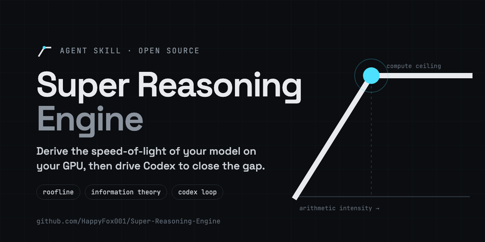

<p align="center">
  
</p>

<h1 align="center">Super Reasoning Engine</h1>

<p align="center">
  <b>Speed-of-light inference engineering as an agent skill.</b><br>
  Derive the physical ceiling of <i>your</i> model on <i>your</i> GPU, then let a supervised Codex loop close the gap.
</p>

<p align="center">
  <a href="#install">Install</a> ·
  <a href="#quickstart">Quickstart</a> ·
  <a href="#how-it-works">How it works</a> ·
  <a href="#the-theory-in-one-page">Theory</a> ·
  <a href="#the-codex-loop">Codex loop</a> ·
  <a href="#repository-layout">Layout</a>
</p>

<p align="center">
  <a href="promo/super-reasoning-engine-promo.mp4">
    
  </a>
  <br>
  <sub>▶ <a href="promo/super-reasoning-engine-promo.mp4">Watch the 30-second promo</a> (with sound): a live run on laya-mlx, Apple M2</sub>
</p>

---

Most inference optimization is folklore: try a flag, try a kernel, see what happens.
**Super Reasoning Engine** (SRE) replaces folklore with a contract and a ceiling:

1. **A ceiling.** Before writing any code, SRE derives the *Speed-of-Light* (SOL) of the
   model × hardware × workload triple from the roofline model, information-theoretic
   bytes-per-token bounds and Little's law, using datasheet peaks *and* measured ceilings.
2. **A gap.** It measures the current engine against that ceiling and decomposes the
   difference into a waterfall: kernel inefficiency, launch gaps, host overhead, batching.
3. **An independently measured loop.** Codex or Claude Code supervises one hypothesis per
   iteration. A separate Codex worker implements it. The supervisor owns the benchmark,
   correctness check, and verdict, then continues or corrects the worker based on the evidence.

The output is an inference engine whose performance is stated as **a percentage of physics**,
not as a speedup over some arbitrary baseline.

## Install

Install the entire folder as `super-reasoning-engine` so your client can discover
`SKILL.md` and access the adjacent scripts, examples, and data. Choose one path per client.

| Client | Project directory | Personal directory | Invoke |
|---|---|---|---|
| Codex | `.agents/skills/super-reasoning-engine` | `~/.agents/skills/super-reasoning-engine` | Find it in Skills or use `$super-reasoning-engine` in CLI/IDE |
| Claude Code | `.claude/skills/super-reasoning-engine` | `~/.claude/skills/super-reasoning-engine` | `/super-reasoning-engine` |

Run the appropriate command from your target inference repository for a project install.
For a personal install, use the corresponding personal destination from the table.

```bash
# Codex
git clone --branch v0.1.0 --depth 1 https://github.com/HappyFox001/Super-Reasoning-Engine.git \
  .agents/skills/super-reasoning-engine

# Claude Code
git clone --branch v0.1.0 --depth 1 https://github.com/HappyFox001/Super-Reasoning-Engine.git \
  .claude/skills/super-reasoning-engine
```

Open a session in the target repository and check the skill picker or the named invocation.
A project-local clone used as a personal tool can go in the target repository's local Git
exclude file. To upgrade a pinned install, fetch tags in its checkout and switch to the
tag listed in [Releases](https://github.com/HappyFox001/Super-Reasoning-Engine/releases).
Use the same operation with an earlier tag to roll back. Removing the installed directory
removes the skill from that scope.

See [Codex skill paths](https://learn.chatgpt.com/docs/build-skills#where-codex-loads-local-skills)
and [Claude Code skill paths](https://code.claude.com/docs/en/skills#choose-where-skills-load).

Release checks used Codex CLI 0.169.0 for automatic selection and the calculator workflow.
Claude Code 2.1.27 listed the project skill at startup. End-to-end Claude Code execution
requires an authenticated client and a reachable model.

## Quickstart

1. Run the [calculator example](examples/sol-quickstart/README.md) with Python 3.9+ on any
   machine. It includes a model config and expected output.
2. In your chosen client, invoke the skill and ask it to estimate the SOL for your model,
   device, precision, and workload. Start with a theoretical estimate to validate the inputs.
3. For measured optimization, set the performance contract and use the
   [dispatch and acceptance guide](references/05-codex-orchestration.md). The
   [Apple M2 MLX case](examples/apple-m2-mlx/README.md) includes a hardware baseline you can reproduce.

### Requirements

| Component | Needed for |
|---|---|
| Python ≥ 3.9 | Calculator, guard, ledger, and wrapper helpers |
| Git and Bash | Candidate worktrees and CLI worker scripts |
| Native Codex subagents or authenticated [Codex CLI](https://github.com/openai/codex) | Implementation worker |
| Accelerator runtime, build tools, and profiler appropriate to the target engine | Real measurements, such as CUDA, ROCm, or Metal/MLX |

The CLI worker uses `workspace-write` by default. GPU builds and measurements can run in
the supervisor's authorized device environment. An isolated runner with explicit permission
can use `--sandbox danger-full-access`.

Pick the Codex model with `SRE_CODEX_MODEL` (for example an Astra-class model such as
`gpt-6.2-astra`). If it isn't set, SRE uses the model in your `~/.codex/config.toml`.

For example, after you have a target engine and GPU, ask your agent:

> *"Use super-reasoning-engine to build the fastest possible decode path for Qwen3-32B on one H100 SXM, FP8 weights allowed, TPOT ≤ 30 ms."*

## How it works

```
 ┌──────────────┐   ┌───────────────────┐   ┌─────────────────┐   ┌────────────────────────┐
 │ A. Contract  │──►│ B. Hardware truth │──►│ C. Speed-of-    │──►│ D. Baseline + gap      │
 │ model, dtype,│   │ datasheet peaks + │   │    Light (SOL)  │   │    waterfall (profile) │
 │ SLO, quality │   │ measured ceilings │   │ sol_calculator  │   │ ledger init            │
 └──────────────┘   └───────────────────┘   └─────────────────┘   └───────────┬────────────┘
                                                                              │
          ┌───────────────────────────────────────────────────────────────────▼──────────┐
          │ E. Codex loop:  PLAN → DISPATCH WORKER → GUARD → VERIFY → PHYSICS CHECK      │
          │                 → VERDICT (accept / reject / correct) → NEXT, until F         │
          └───────────────────────────────────────────────────────────────────┬──────────┘
                                                                              │
                                          ┌───────────────────────────────────▼──────────┐
                                          │ F. Stop: target % of SOL, asymptote,          │
                                          │    contract limit, or budget → REPORT.md      │
                                          └──────────────────────────────────────────────┘
```

## The theory in one page

The binding question: *what is the minimum time to produce one token?*

```
t_step ≥ max( FLOPs / P_compute , Bytes / BW_mem , Comm ) + t_fixed
```

| Regime | Dominant term | Bound |
|---|---|---|
| Prefill (long prompts) | compute | `t ≥ (2·N·S + 2·L·S²·H·d) / P` |
| Decode, small batch | memory | `t ≥ (W_active·b_w + B·ctx·KV_tok) / BW` |
| Decode, large batch | compute | above `B* ≈ (P/BW)·(b_w/2)`: about 295 for BF16 on H100 |
| Tensor parallel | interconnect | `2·(p−1)/p · msg / BW_link + hops·α` per all-reduce |

**The information-theoretic view.** A decode step must move at least the information content
of the active weights and the attended KV cache, at the distortion the quality contract
allows. Only three things change that floor:

- **Rate:** fewer bits per weight or KV element (quantization; rate-distortion trade-off).
- **Reuse across sequences:** batching, i.e. the same bytes serve `B` tokens.
- **Reuse across time:** speculative decoding, i.e. the same bytes serve
  `(1−α^{k+1})/(1−α)` tokens in expectation, where `α` is driven by how predictable (low
  entropy) the target distribution is relative to the draft.

Everything else (fusion, graphs, better kernels, scheduling) removes *overhead above* the
floor. SRE always tells you which of the two kinds of work you are doing.

Full derivations are in [`references/01-first-principles.md`](references/01-first-principles.md).

See the [calculator quickstart](examples/sol-quickstart/README.md) for a runnable command.

## The Codex loop

The supervisor independently evaluates the implementation worker's patch.

| Step | Who | Tool |
|---|---|---|
| Plan one hypothesis with a predicted gain | Supervisor | Gap waterfall and `ledger.py show` |
| Implement in a candidate worktree | Codex worker | Native subagent or `codex_task.sh` |
| Verify scope and correctness | Supervisor | Guard JSON verdict, frozen correctness check |
| Benchmark and record verdict | Supervisor | Frozen benchmark, SLOs, and `ledger.py add` |
| Correct drift in the same session | Supervisor → worker | Native follow-up or `codex_correct.sh` |

Drift patterns SRE detects and corrects: benchmark gaming, precision-contract violations,
impossible (> SOL) numbers, rabbit holes, scope creep, fix-forward spirals, premature victory
claims and environment thrash. See [`references/06-drift-detection.md`](references/06-drift-detection.md).

## Troubleshooting

| Symptom | Check |
|---|---|
| The skill is missing | Check your launch directory and install scope. Confirm `super-reasoning-engine/SKILL.md` exists, then reopen the session. |
| A script or input cannot be found | Resolve skill scripts from the installed folder. Resolve model inputs, Git state, and experiment artifacts from the target engine repository. |
| The worker sees no GPU | Check permissions and device access in the worker environment. Run authoritative measurements in the supervisor's device environment. |
| A CLI worker fails or cannot resume | Check `meta.json`, `events.jsonl`, and `stderr.log`. Resume using the printed `RUN_DIR` and the original permission mode. If the session has expired, start a fresh worker from the pinned base and include the diagnosis. |

## Repository layout

```
SKILL.md                         entry point the agent loads
references/
  01-first-principles.md         roofline, information-theoretic bounds, queueing
  02-hardware-characterization.md datasheet vs achievable, microbenchmarks
  03-workload-model.md           prefill/decode, KV, GQA/MLA, MoE, long context, multi-GPU
  04-optimization-playbook.md    lever catalog, expected gains, pitfalls
  05-codex-orchestration.md      native and CLI workers, acceptance, recovery
  06-drift-detection.md          drift taxonomy and correction playbook
  07-measurement-protocol.md     benchmark rigor and statistics
scripts/
  sol_calculator.py              speed-of-light calculator (reads HF config.json)
  codex_task.sh                  dispatch a task to Codex, log session
  codex_correct.sh               resume the same Codex session with a correction
  guard.py                       post-Codex diff guard
  ledger.py                      experiment ledger with SOL-fraction and noise checks
templates/                       contract, AGENTS.md, task, correction, SOL report, final report
examples/                        calculator quickstart and measured inference baseline
tests/                           script regression tests and skill selection prompts
assets/hardware.json             datasheet peaks for common accelerators
```

## Design principles

- **State performance as a fraction of physics.** "2× faster" is meaningless; "88% of
  achievable HBM SOL at B=64" is a fact.
- **Separate the author from the judge.** Codex writes; the orchestrator measures.
- **One hypothesis, one diff, one number.** Attribution beats velocity.
- **Freeze the workload.** The contract changes only with a human decision.
- **Never stop at the first plateau.** Re-derive the waterfall; the largest bar is the next task.

## Contributing

Contributions are welcome: hardware entries (with datasheet sources), new drift detectors,
model-family workload notes (MLA, hybrid SSM/attention, diffusion LMs), and case studies
with reproducible ledgers. Please keep `scripts/` dependency-free.

Run `python3 -m unittest discover -s tests -v` from this repository. CI runs the same
suite on Linux and macOS. Use the [skill selection prompts](tests/skill-prompts.md) to
check live client behavior separately.

## License

MIT, see [LICENSE](LICENSE).
